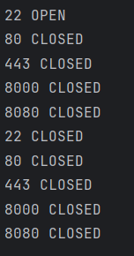
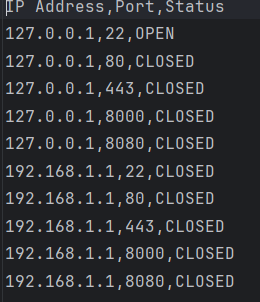
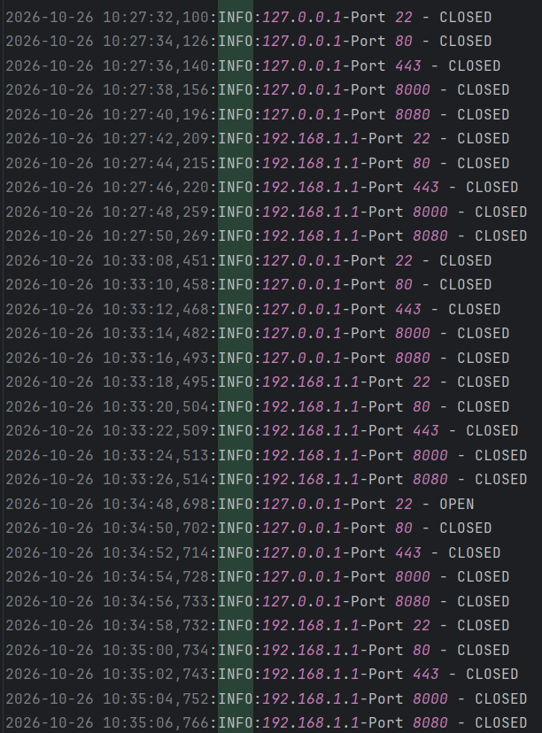
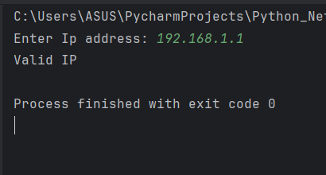

# Python Network Security Scanner

## About
A Python-based network security scanner that checks open and closed
ports on target IP addresses.

## Features

- IP address Validation
- Multiple Ip Scanning
- Multiple Port Scanning
- Open and Closed Port Detection
- CSV Report Generation
- Logging
- Error Handling


## Technologies

-Python
-Socket
-IPaddress
-CSV
-Logging


## How to Run

````bash
python scanner.py

## Output

- 'scan_results.csv' - contains Ip addresses,ports and scan status
- 'scanner.log' - Contains scan acitivity and logs.

## Screenshots

### Port Scanning



### CSV Report


### Logging


### Ip validation



